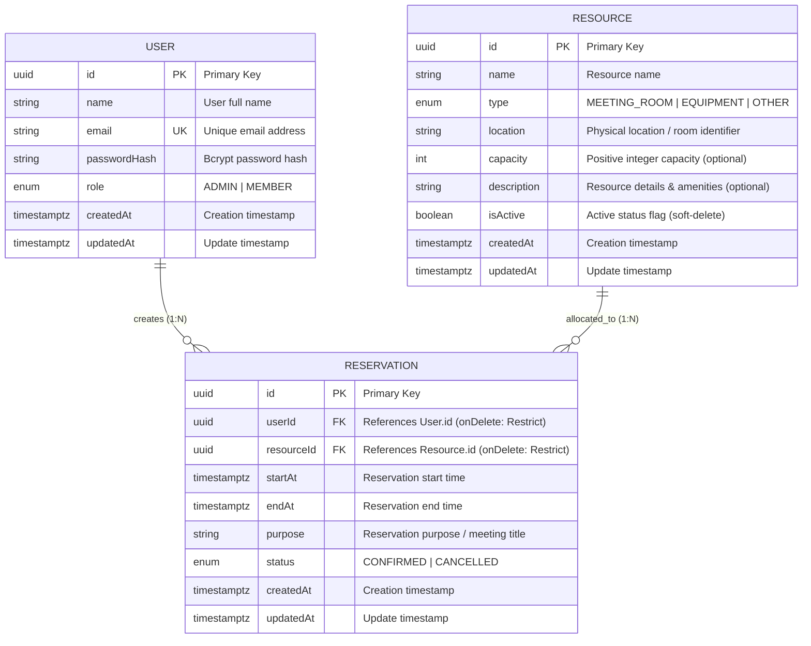

# ReserveHub Entity Relationship (ER) Diagram & Database Design

This document details the database schema, relational structure, constraints, and index design for ReserveHub.

---

## 1. Entity Relationship (ER) Diagram (Mermaid)



---

## 2. DBML Schema (For dbdiagram.io Shareable Link)

Copy and paste the DBML below into [dbdiagram.io](https://dbdiagram.io) to generate an interactive, shareable public link for your submission:

```dbml
// ReserveHub Database Schema
// Paste this directly into https://dbdiagram.io

enum Role {
  ADMIN
  MEMBER
}

enum ResourceType {
  MEETING_ROOM
  EQUIPMENT
  OTHER
}

enum ReservationStatus {
  CONFIRMED
  CANCELLED
}

Table User {
  id uuid [pk, default: `gen_random_uuid()`]
  name varchar(255) [not null]
  email varchar(255) [unique, not null]
  passwordHash varchar(255) [not null]
  role Role [not null, default: 'MEMBER']
  createdAt timestamptz [not null, default: `now()`]
  updatedAt timestamptz [not null, default: `now()`]

  Note: 'Application users: Administrators and Members with isolated reservations'
}

Table Resource {
  id uuid [pk, default: `gen_random_uuid()`]
  name varchar(255) [not null]
  type ResourceType [not null]
  location varchar(255) [not null]
  capacity int [note: 'CHECK (capacity > 0 OR capacity IS NULL)']
  description text
  isActive boolean [not null, default: true]
  createdAt timestamptz [not null, default: `now()`]
  updatedAt timestamptz [not null, default: `now()`]

  indexes {
    (isActive, type) [name: 'idx_resource_active_type']
  }

  Note: 'Physical rooms and equipment available for reservation'
}

Table Reservation {
  id uuid [pk, default: `gen_random_uuid()`]
  userId uuid [not null, ref: > User.id]
  resourceId uuid [not null, ref: > Resource.id]
  startAt timestamptz [not null]
  endAt timestamptz [not null]
  purpose text [not null]
  status ReservationStatus [not null, default: 'CONFIRMED']
  createdAt timestamptz [not null, default: `now()`]
  updatedAt timestamptz [not null, default: `now()`]

  indexes {
    (userId, startAt) [name: 'idx_reservation_user_start']
    (resourceId, status, startAt) [name: 'idx_reservation_res_status_start']
    (status, startAt) [name: 'idx_reservation_status_start']
    (startAt, endAt) [name: 'idx_reservation_time_range']
  }

  Note: 'Bookings with PostgreSQL btree_gist exclusion lock preventing double-booking race conditions'
}
```

---

## 3. Database Constraints & Concurrency Architecture

### A. Double-Booking Prevention via PostgreSQL Exclusion Constraint
Race conditions can easily bypass traditional application-level checks (`SELECT ... WHERE NOT EXISTS`). ReserveHub uses PostgreSQL's `btree_gist` extension with an exclusion constraint (`EXCLUDE USING gist`) to guarantee zero double-bookings at the database engine level:

```sql
CREATE EXTENSION IF NOT EXISTS btree_gist;

ALTER TABLE "Reservation"
ADD CONSTRAINT "reservation_no_overlap"
EXCLUDE USING gist (
  "resourceId" WITH =,
  tstzrange("startAt", "endAt", '[)') WITH &&
)
WHERE ("status" = 'CONFIRMED');
```

- **Interval Convention `[)`**: Half-open interval `[startAt, endAt)` ensures that back-to-back bookings (e.g., 09:00–10:00 and 10:00–11:00) succeed with zero conflict.
- **Partial Index Filter**: Overlaps are only checked against `CONFIRMED` reservations. Once a reservation is `CANCELLED`, its slot is instantly released for other members.

### B. Relational Integrity & Deletion Rules
- `onDelete: Restrict`: Prevents cascading deletions of Users or Resources that have existing reservation history, ensuring auditability and historical integrity.
- **Soft Deactivation**: Resources are marked `isActive = false` instead of physically deleted. Active bookings remain intact while new bookings are prevented.

### C. Validation Check Constraints
- `reservation_valid_time`: `CHECK ("endAt" > "startAt")` guarantees that booking intervals are forward-progressing.
- `resource_positive_capacity`: `CHECK ("capacity" IS NULL OR "capacity" > 0)` ensures realistic capacity limits.

