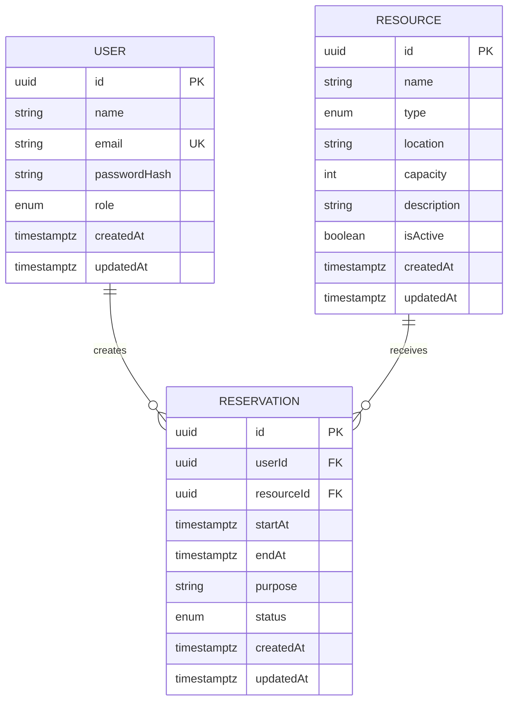

# ReserveHub database design

## Constraints

- User email is unique.
- Reservation end time must be after start time.
- Capacity must be positive when specified.
- Confirmed reservations for the same resource cannot overlap.
- Booking intervals use [start, end), allowing back-to-back bookings.
- Foreign keys prevent deletion of users/resources with reservations.
- Cancelled reservations are retained as history.
